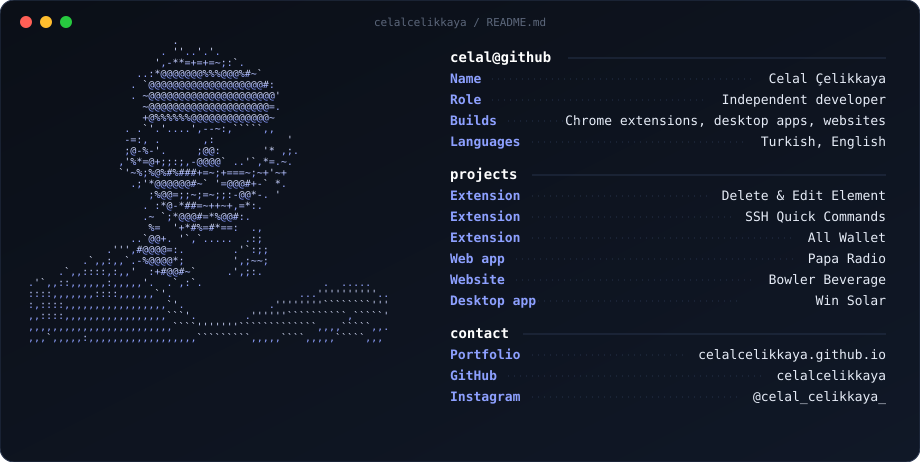

 

## What I've built

| Project | What it is |
| --- | --- |
| **[Delete & Edit Element](https://chromewebstore.google.com/detail/delete-edit-element/ocikgjijppfibagbecmeecchbgkjljpc)** | Chrome extension: click anything on a page to remove or edit it, undo any time. |
| **[SSH Quick Commands](https://chromewebstore.google.com/detail/ssh-quick-commands/hjfnapcnlkpcamkmkolnaphmbfemfpjh)** | Chrome extension: your terminal commands one click away, copied straight to the clipboard. |
| **[All Wallet](https://chromewebstore.google.com/detail/all-wallet/ljnjpagnmhjionebkgmjlkpocooimokj)** | Chrome extension: a crypto wallet and bank address book with an optional password lock. |
| **ThinkerBTC** | Self-learning Binance Futures trading bot: three-layer trend handshake, structure-based TP / SL, ATR trailing with profit lock, live operator dashboard and investor portal. [Try the dashboard](https://celalcelikkaya.github.io/demo-thinkerbtc-dashboard.html) · [Try the investor portal](https://celalcelikkaya.github.io/demo-thinkerbtc-investor.html) · private repository, access on request (demos use sample data). |
| **[Win Solar](https://github.com/celalcelikkaya/win-solar)** | Windows desktop app: automatically switches between light and dark themes based on local sunrise and sunset. [Download for Windows](https://github.com/celalcelikkaya/win-solar/releases/latest/download/Setup.zip) |
| **[Orphanage Manager](https://github.com/celalcelikkaya/orphanage-manager)** | Web app: a fund, donation and accounting system for orphanages with multi-manager workflows, built on Google Apps Script and Google Sheets. [Download](https://github.com/celalcelikkaya/orphanage-manager/releases/latest/download/orphanage-manager-main.zip) |
| **[Field Sales Tracker](https://github.com/celalcelikkaya/Field-sales-tracker)** | Web app: salesmen record sales, credit and payments from their phones while the owner sees everything live, with a customer registry and a full ledger, built on Google Apps Script and Google Sheets. [Live demo](https://celalcelikkaya.github.io/demo-field-sales.html) · [Download](https://github.com/celalcelikkaya/Field-sales-tracker/releases/download/v1.0.0/sales-dashboard-v1.0.0.zip) |
| **[Papa Radio](https://www.paparadio.online)** | A radio web app that brings stations together in one place. |
| **[Bowler Beverage](https://www.bowlerbeverage.com)** | Business website for a Malawi beverage company. |

Everything above lives on my [portfolio](https://celalcelikkaya.github.io/).
