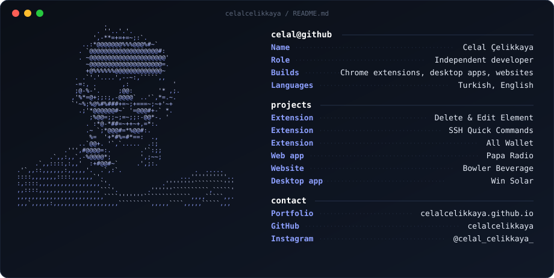
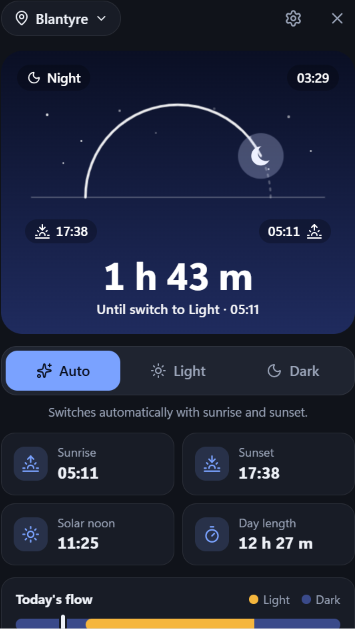

 

**[Portfolio](https://celalcelikkaya.github.io/)**  ·  **[Instagram](https://www.instagram.com/celal_celikkaya_/)**

## What I've built

| Project | What it is |
| --- | --- |
| **[Delete & Edit Element](https://chromewebstore.google.com/detail/delete-edit-element/ocikgjijppfibagbecmeecchbgkjljpc)** | Chrome extension: click anything on a page to remove or edit it, undo any time. |
| **[SSH Quick Commands](https://chromewebstore.google.com/detail/ssh-quick-commands/hjfnapcnlkpcamkmkolnaphmbfemfpjh)** | Chrome extension: your terminal commands one click away, copied straight to the clipboard. |
| **[All Wallet](https://chromewebstore.google.com/detail/all-wallet/ljnjpagnmhjionebkgmjlkpocooimokj)** | Chrome extension: a crypto wallet and bank address book with an optional password lock. |
| **Win Solar** | Windows desktop app: automatically switches between light and dark themes based on local sunrise and sunset. No public link yet. |
| **[Papa Radio](https://www.paparadio.online)** | A radio web app that brings stations together in one place. |
| **[Bowler Beverage](https://www.bowlerbeverage.com)** | Business website for a Malawi beverage company. |

Everything above lives on my [portfolio](https://celalcelikkaya.github.io/).
